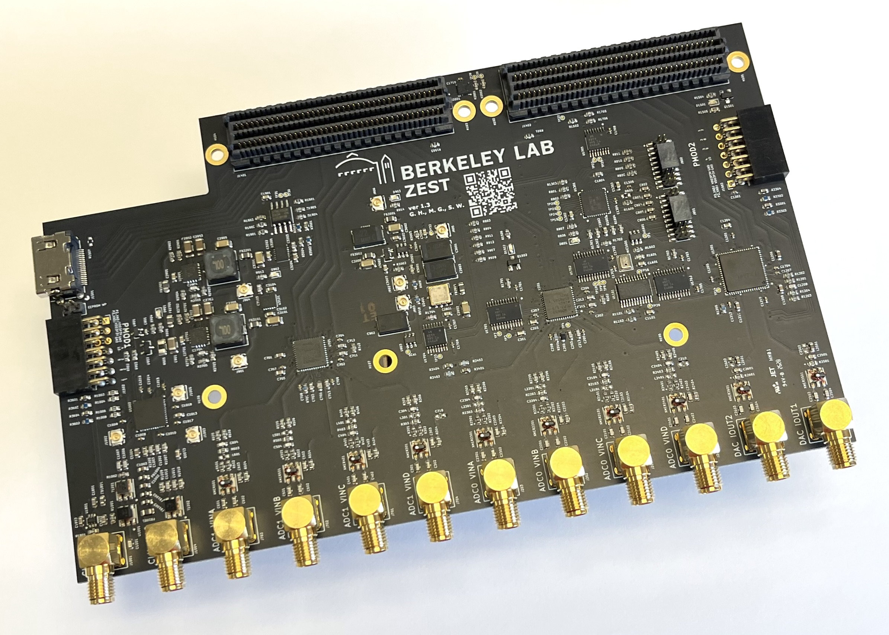

# Zest board

Zest (Z=e^(st)) is a double FMC mezzanine board performing Analog to Digital and Digital to Analog conversions.
This board is mainly used as a part of Radio Frequency (RF) controls electronics systems in particle accelerators.
Over 400 units have been manufactured by Berkeley Lab and SLAC National Laboratories and is the ADC/DAC board base design of the
LCLS-II (Linac Coherent Light Source II) Low-Level RF (LLRF) system at SLAC.

This board is designed in KiCad 10.0.
The original Zest board board can be found as v1.1 and below, which use gEDA and PADS for the schematic and layout design.
This design was skillfully ported to KiCad by Gang Huang (designated as v1.2) and purposefully uses the exact same traces/vias/zones as v1.1, except:

* The simple R/C/L footprints use the built-in footprints from KiCad, so those pad sizes are slightly different from the original Gerber.
* The other footprints are directly downloaded from different online repos, including digikey.com and snapeda.com.
* The footprint files are not included because they are not licensed for redistribution.
* The reference ID for each component has changed because the KiCad and gEDA manage the hierarchical sheets / subcircuit differently. A mapping of the v1.2 and v1.1 part reference ID can be found in the partsub.json.

The history and credit of the board can be found in the boardhistoryandcredit file.

 

The Zest board features:

* 8 x transformer-coupled inputs sampled at 95 MS/s (2 x AD9653)
* 2 x transformer-coupled outputs sampled at 190 MS/s (AD9781)
* Input clock source up to 3 GHz (LMK01801, no on-board oscillator)
* Extra clock divider output
* 2 x Pmod digital I/O
* Interface to FPGA via dual-LPC-FMC connectors
* 181.8 x 110 mm, 8-layer, with notch to accommodate Xilinx FMC eval boards, also known to work with [Marble](https://github.com/BerkeleyLab/Marble) and [Marble-Mini](https://github.com/BerkeleyLab/Marble-Mini)
* 4W power dissipation

## Schematics

To get PDF versions for reference:

  `make pdf` 

### Generate fabrication package
`make fab`

It will download the Gerber.py script from the [BIDS repo](https://gitlab.com/lbl-bids/kicad_library) and use it to generate the Gerber, drill, bom and xyposition files. I didn't include the whole BIDS as submodule because I don't feel it's necessary, as I am only using this single file here.

### Generate QR code for SN

`make qrsn SNSTART=10 SNSTOP=20`

This will generate the Gerber file for 10 different serial numbers. The generated Gerbers can be found in the directory

`ls qrsngbr`

### Generate zip file
`make zip SNSTART=10 SNSTOP=20`

This will generate a zip file containing files from the fab and the qrsngbr directories.

### Generate tarball file
`make tarball SNSTART=10 SNSTOP=20`

This will generate a .tar.gz file containing files from the fab and the qrsngbr directories.

## Mechanical Designs

### Heat Sink

A custom heat sink was designed to distribute and dissipate the heat generated by the Zest board. A Solidworks part, technical drawing, and .STL file are included in the mechanical designs directory. 

### Plastic Cover

One corner of the digitizer (by J3, clock input) has some fragile transformers
very close to where SMA wrenches are used.
It has proved helpful to have a protective cover in place to avoid damage.
This is designed in [OpenSCAD](http://www.openscad.org/) with a process that
matches up its features with the Gerber file; see covergen.py.
The OpenSCAD source file is cover1.scad.
OpenSCAD will export an STL file which is easily 3-D printed.
We also include a more compact Solidworks generated STL file (narrow_cover.STL) which can be mounted on the board using 1/4" adhesive strips.

## References

 G. Huang, L. R. Doolittle, J. Yang, Y. Xu,
*"Low Noise Digitizer Design for LCLS-II LLRF,"* in NAPAC2016
[TUPOA40](https://accelconf.web.cern.ch/napac2016/papers/tupoa40.pdf).

## Copyright

Zest Copyright (c) 2019, The Regents of the University of California, through Lawrence Berkeley National Laboratory (subject to receipt of any required approvals from the U.S. Department of Energy), and The Board of Trustees of the Leland Stanford Junior University. All rights reserved.

This documentation describes Zest and is licensed under the CERN OHL v. 1.2.

NOTICE. This documentation was developed under funding from the U.S. Department of Energy and the U.S. Government consequently retains certain rights. As such, the U.S. Government has been granted for itself and others acting on its behalf a paid-up, nonexclusive, irrevocable, worldwide license in the documentation to reproduce, distribute copies to the public, prepare derivative works, and perform publicly and display publicly, and to permit others to do so.

You may redistribute and modify this documentation under the terms of the CERN OHL v.1.2. (http://ohwr.org/cernohl). THIS DOCUMENTATION IS PROVIDED BY THE COPYRIGHT HOLDERS AND CONTRIBUTORS "AS IS" AND ANY EXPRESS OR IMPLIED WARRANTIES, INCLUDING, BUT NOT LIMITED TO, THE IMPLIED WARRANTIES OF MERCHANTABILITY AND FITNESS FOR A PARTICULAR PURPOSE ARE DISCLAIMED. IN NO EVENT SHALL THE COPYRIGHT OWNER OR CONTRIBUTORS BE LIABLE FOR ANY DIRECT, INDIRECT, INCIDENTAL, SPECIAL, EXEMPLARY, OR CONSEQUENTIAL DAMAGES (INCLUDING, BUT NOT LIMITED TO, PROCUREMENT OF SUBSTITUTE GOODS OR SERVICES; LOSS OF USE, DATA, OR PROFITS; OR BUSINESS INTERRUPTION) HOWEVER CAUSED AND ON ANY THEORY OF LIABILITY, WHETHER IN CONTRACT, STRICT LIABILITY, OR TORT (INCLUDING NEGLIGENCE OR OTHERWISE) ARISING IN ANY WAY OUT OF THE USE OF THIS SOFTWARE, EVEN IF ADVISED OF THE POSSIBILITY OF SUCH DAMAGE. Please see the CERN OHL v.1.2 for applicable conditions.